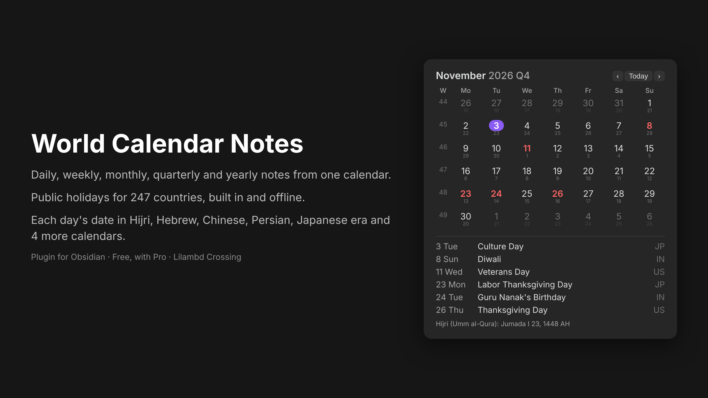

# World Calendar Notes

A calendar in your Obsidian sidebar that opens and creates your **daily, weekly, monthly, quarterly and yearly notes**, shows **public holidays for 247 countries**, and can show each day's date in **another calendar** (Hijri, Hebrew, Chinese, Persian, Japanese era, Buddhist, Coptic, Ethiopian, Indian national).

## Features
- Click a day for its daily note, a week number for the weekly note, the month, year or quarter for those notes. Ctrl/Cmd-click opens in a new tab.
- Each period has its own folder, file-name format (Moment.js, subfolders allowed) and template.
- Template variables: `{{title}}`, `{{date}}`, `{{date:FORMAT}}`, `{{time}}`, `{{yesterday}}`, `{{tomorrow}}`, `{{holidays}}`, `{{altdate}}`.
- Commands: open today's / this week's / month's / quarter's / year's note; open next or previous note of the same period.
- Week starts on Monday (ISO), Sunday, or your app language.
- Holidays work offline. Data covers 2026–2030 and is updated every year.

## Installation
1. In Obsidian, open **Settings → Community plugins** and turn off Restricted mode if it is on.
2. Select **Browse**, search for **World Calendar Notes**, then select **Install** and **Enable**.
3. Manual install: download `main.js`, `manifest.json` and `styles.css` from the latest [release](https://github.com/Veniwol-Li-Lambd/world-calendar-notes/releases) into `<your vault>/.obsidian/plugins/world-calendar-notes/`, then enable the plugin.

## Usage
1. Open the calendar with the calendar icon in the left ribbon, or run **World Calendar Notes: Show calendar** from the command palette.
2. Click a day to open or create that day's note. Click a week number, the month name, the year or the quarter for those notes.
3. In **Settings → World Calendar Notes**, choose the folder, file-name format and template for each kind of note, and pick your country for holidays.
4. Use the commands **Open next note** and **Open previous note** to move between notes of the same kind.

## Free and Pro
Free: everything above, with holidays for one country.
**Pro (one-time purchase)** adds:
- holidays for any number of countries at once (good for remote teams and families abroad)
- bank, optional, religious and school days, not only public holidays
- the second-calendar line under each date and `{{altdate}}` in templates

Pro is unlocked with a licence key from Gumroad. The key is checked once with Gumroad's licence API (`api.gumroad.com`). No other network calls are made and no note content ever leaves your device.

## Moving from Calendar and Periodic Notes
Use the same folders and formats you had in Periodic Notes. Existing notes are found and marked with a dot.

## Data
Holiday dates come from python-holidays (MIT). Dates marked * depend on moon sighting and can move by a day. Other calendars use your system's built-in `Intl` calendars.

## Licence
Code: MIT. Made by Lilambd Crossing.
